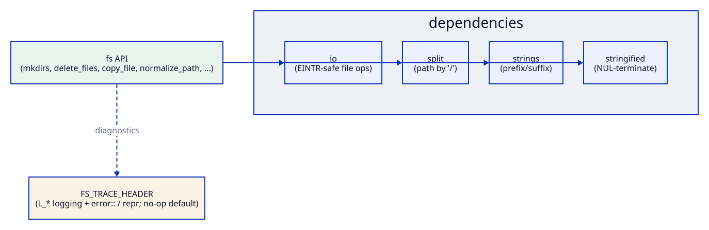

# fs

[](https://github.com/Kronuz/fs/actions/workflows/ci.yml)
[](LICENSE)


The filesystem chores a database server needs, in C++20: create a directory chain,
delete or quarantine files by glob, copy or move a tree, and normalize a path without
touching the disk.



## ✨ Highlights

- 📁 **`mkdirs`**: the whole chain in one call.
- 🧹 **`delete_files`** by glob, removing the directory when it ends up empty.
- 🚧 **`quarantine_files`**: rename suspect files aside instead of deleting them.
- 📋 **`copy_file` and `move_files`** for directory trees.
- ✂️ **`normalize_path`**: collapses `.`, `..`, and repeated `/` as a pure string
  operation.
- 🛡️ **EINTR-safe** through [io](https://github.com/Kronuz/io); logging is an optional
  seam (`FS_TRACE_HEADER`).

## 📦 Installation

Requires a C++20 compiler, a POSIX system, and CMake 3.14 or newer. It brings
[io](https://github.com/Kronuz/io), [strings](https://github.com/Kronuz/strings),
[split](https://github.com/Kronuz/split), and
[stringified](https://github.com/Kronuz/stringified). CI builds it on Linux (x86_64,
arm64), macOS (arm64, x86_64), and FreeBSD, plus ASan, UBSan, and TSan builds.

```cmake
include(FetchContent)
FetchContent_Declare(fs
  GIT_REPOSITORY https://github.com/Kronuz/fs.git
  GIT_TAG        main)
FetchContent_MakeAvailable(fs)

target_link_libraries(my_app PRIVATE fs::fs)
```

## 🚀 Quick start

```cpp
#include "fs.hh"

#include <cassert>

int main() {
	mkdirs("data/shard/3");                          // the whole chain
	assert(exists("data/shard/3"));
	delete_files("data/shard/3", {"*.tmp", "*.lock"}); // and rmdir if it ends up empty
	assert(normalize_path("a/b/../c") == "a/c");     // no disk access
}
```

## 🧰 API

| Function | Does |
| --- | --- |
| `normalize_path(p, slashed, keep_slash)` | pure-string collapse of `.` / `..` / repeated `/` |
| `exists(p)` / `mkdir(p)` / `mkdirs(p)` | stat / single dir / recursive dir chain |
| `delete_files(p, patterns)` | `fnmatch`-delete matching files; `rmdir` the dir if it ends up empty |
| `quarantine_files(p, patterns, suffix)` | rename matching files aside (into a `mkstemp` suffix) instead of deleting |
| `move_files(src, dst)` / `copy_file(...)` | move / recursively copy a directory tree |
| `opendir(p, create)` / `find_file_dir(...)` | directory iteration helpers |
| `build_path_index(p)` | create the index directory chain for a path |

All functions are in the global namespace and take `std::string_view` paths.

## 🎯 When to use it

- ✅ Server code that manages its own data directories on POSIX systems.
- ❌ General-purpose path work: prefer `std::filesystem`, which covers most of this
  portably.

## 📚 Documentation

- [ARCHITECTURE.md](ARCHITECTURE.md): how each helper works and fails.
- [examples/db_layout.cc](examples/db_layout.cc): a self-checking, Xapiand-style
  database layout.
- [AGENTS.md](AGENTS.md): repository map and invariants.

## 🛠️ Building and testing

```sh
cmake -B build -DCMAKE_BUILD_TYPE=Release && cmake --build build
ctest --test-dir build
```

## 🤝 Contributing

Issues and pull requests are welcome. Read [AGENTS.md](AGENTS.md) first. CI must
pass on every platform.

## 📄 License

MIT, Copyright (c) 2015-2019 Dubalu LLC. See [LICENSE](LICENSE). Extracted from
[Xapiand](https://github.com/Kronuz/Xapiand).
